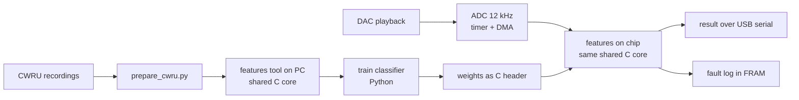

# Architecture

## Why one shared C core

Features are written once, in C. On the PC they produce the training data; on
the chip they run live. Training and the device cannot disagree.

## Data

The healthy recordings were sampled at 48 kHz and the fault recordings at
12 kHz. All recordings are converted to 12 kHz before anything else, so the
classifier cannot learn the sample rate instead of the fault.
